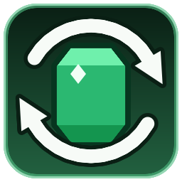

<div align="center">



# Reroll Trades Plus

**Кнопка реролла сделок жителей для Minecraft 26.3 (Fabric)**


</div>

## Зачем этот мод

В ванильном Minecraft сделки жителя генерируются один раз при его прокачке. Чтобы получить «удачные» сделки (например, дешёвые ноты защищающего или максимальную скидку от бронника), игроки ломают и расставляют обратно стойки, убивают жителей или фермят новых — это муторно.

**Reroll Trades Plus** добавляет в экран торговли кнопку с иконкой ↻: одно нажатие — и житель получает **свежий полный набор сделок** того же уровня и профессии. Никакого гринда ради рандома — но и не бесплатно: за реролл платим изумрудами, чем выше уровень жителя — тем дороже.

## Возможности

- Кнопка-иконка ↻ в правом верхнем углу списка сделок (рядом с заголовком «Trades»).
- Реролл генерирует сделки **по всем уровням 1..N** через ванильные наборы (`TradeSet`) — житель 4-го уровня получает весь свой набор, а не только сделки верхнего уровня.
- Подсказка при наведении показывает текущую цену; если изумрудов не хватает, кнопка сразу становится серой.
- Кнопка видна **только если на сервере стоит мод** — на ванильном сервере интерфейс остаётся нетронутым.
- Локализация: английская и русская.

## Стоимость реролла

| Уровень сделок жителя | Цена |
|:---|---:|
| Обычный (Novice) | 1 💚 |
| Подмастерье (Apprentice) | 2 💚 |
| Ремесленник (Journeyman) | 4 💚 |
| Эксперт (Expert) | 8 💚 |
| Мастер (Master) | 16 💚 |

Цены заданы в `RerollCost.EMERALDS_PER_LEVEL` и используются и клиентом (подсказка и блокировка кнопки), и сервером (списание). Изумруды списываются только на серверной стороне; у жителей без профессий (нитвиты) оплата не взимается.

## Как это работает

Мод разделён на клиентскую и серверную часть (split source sets) и общается одним кастомным пакетом.

**Клиент**

- `MerchantScreenMixin` добавляет `RerollButton` в конец `MerchantScreen.init()` через ванильный `addRenderableWidget()`.
- Доступ к координатам экрана — через accessor-миксин `AbstractContainerScreenAccessor` (поля `leftPos`/`topPos` объявлены в родительском классе, а в 26.3 у Minecraft нет обфускации и mixin refmap, поэтому `@Shadow` унаследованных полей невозможен).
- Каждый кадр в `extractContents()` кнопка пересчитывает состояние: цену по уровню жителя (`MerchantMenu#getTraderLevel`), наличие изумрудов у игрока и кадр текстуры (обычный / наведение / недоступный).
- Нажатие отправляет пустой payload `reroll_trades_plus:reroll_trades` — сервер сам знает, с каким торговцем открыт экран, поэтому подменить цель нельзя.

**Сервер**

Обработчик `ServerPlayNetworking` выполняется в потоке сервера и:

1. достаёт торговца из открытого у игрока `MerchantMenu` и проверяет валидность (`stillValid` — дистанция, живучесть; наблюдателю отказано);
2. списывает изумруды (`RerollCost#tryCharge`); при нехватке — сообщение и выход;
3. очищает сделки и через invoker-миксины повторяет **ванильную** генерацию: `AbstractVillager#addOffersFromTradeSet` для каждого уровня 1..N профессии жителя;
4. `Villager#updateSpecialPrices` пересчитывает скидки (репутация, «Герой деревни») и рассылает новые предложения клиенту через `sendMerchantOffers`.

Никакие данные о сделках не хранятся модом — используются только механизмы ванили, поэтому реролл совместим с датапаками, меняющими торговлю.

## Установка

1. Установите [Fabric Loader](https://fabricmc.net/use/) для Minecraft 26.3.
2. Положите в `mods`:
   - [Fabric API](https://modrinth.com/mod/fabric-api) `0.165.2+26.3` или новее;
   - `reroll-trades-plus-1.0-beta.jar` (см. [Releases](../../releases)).
3. Мод нужен и на клиенте, и на сервере. В одиночной игре достаточно клиента.

## Сборка из исходников

Нужен **JDK 25**.

```bash
./gradlew build        # Linux/macOS
gradlew.bat build      # Windows
```

Готовый jar появится в `build/libs/reroll-trades-plus-1.0-beta.jar`.

> Первый запуск скачивает Minecraft, маппинги и декомпилирует исходники — это занимает несколько минут.

## Структура проекта

```
src/main/java/com/nullcoder/rerolltradesplus/
├── RerollTradesPlus.java        # entrypoint: регистрация пакета и обработчика
├── RerollTradesPayload.java     # кастомный C2S-пакет
├── RerollCost.java              # таблица цен и списание изумрудов
└── mixin/                       # доступ к ванильной генерации сделок
src/client/java/com/nullcoder/rerolltradesplus/client/
├── RerollButton.java            # кнопка ↻ (иконка, цена, состояние)
└── mixin/MerchantScreenMixin.java
src/main/resources/assets/reroll_trades_plus/
├── icon.png                     # иконка мода
├── lang/{en_us,ru_ru}.json
└── textures/gui/reroll_button.png
```

## English (short)

**Reroll Trades Plus** adds a ↻ button to the villager trading screen (Minecraft 26.3, Fabric). One click regenerates the villager's full offer set via vanilla `TradeSet` mechanics. Rerolling costs emeralds — the price scales with the villager's trade level (1/2/4/8/16). The button only appears when the server has the mod; all validation happens server-side.

## Лицензия

CC0-1.0 — делайте что хотите.
